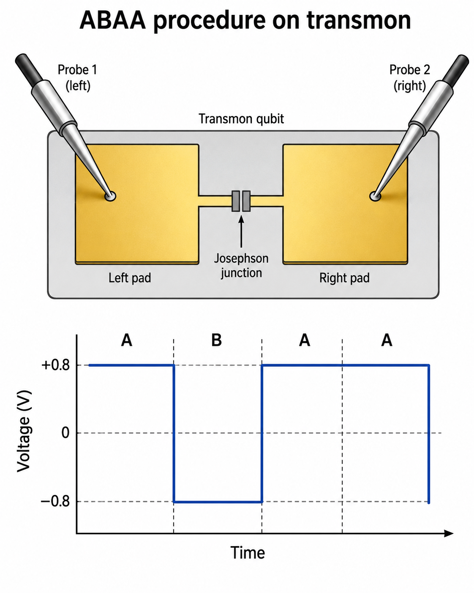
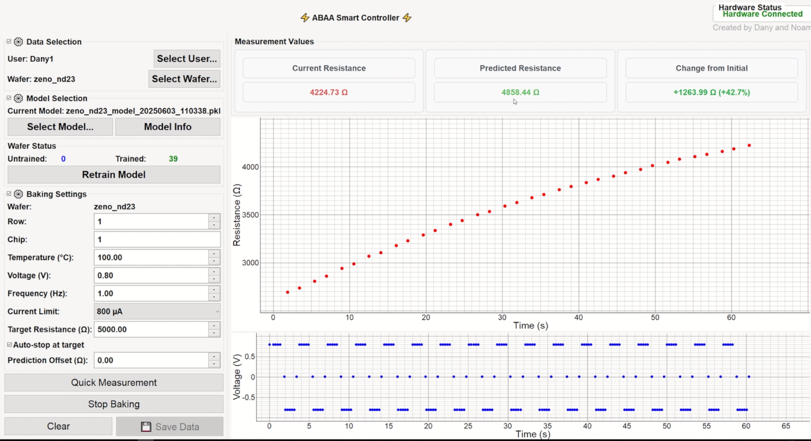
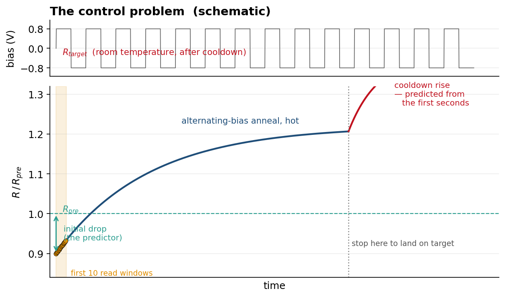
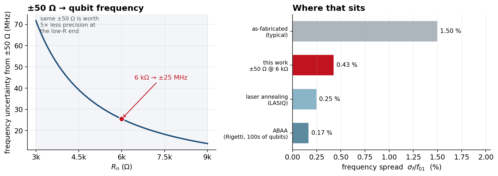

<div align="center">

# ABAA Smart Controller

**Closed-loop control and endpoint prediction for alternating-bias assisted annealing of Josephson junctions — room-temperature trimming of transmon qubit frequency.**

[](https://www.python.org/)
[](https://pypi.org/project/PyQt5/)
[](https://scikit-learn.org/)
[](https://pyvisa.readthedocs.io/)
[](LICENSING.md)



**Closed-loop auto-stop: RMSE 44 Ω on 6 kΩ junctions — ±22 MHz of transmon frequency.**



*Live run. Current 4225 Ω, predicted post-cooldown 4858 Ω, target 5000 Ω — the anneal stops itself when the prediction reaches target.*

</div>

---

## Why this exists

A transmon's transition frequency is set by its Josephson energy, which is set by the critical current of one sub-micron Al/AlO<sub>x</sub>/Al tunnel junction. Fabrication spread on that junction becomes frequency spread on the chip, and frequency collisions between neighbours are among the dominant yield limits for multi-qubit processors. Typical as-fabricated tolerances run 2–4 % in junction resistance, which is 1–2 % in frequency.

The Ambegaokar–Baratoff relation, I<sub>c</sub>R<sub>n</sub> = πΔ/2e, ties critical current to the junction's **room-temperature normal-state resistance**. So trimming R<sub>n</sub> on a probe station — before the chip ever sees a dilution refrigerator — trims qubit frequency.

**Alternating-bias assisted annealing (ABAA)**, introduced by Pappas *et al.* at Rigetti ([*Communications Materials*, 2024](https://www.nature.com/articles/s43246-024-00596-z)), applies an alternating bias across a gently heated junction to re-order atoms in the amorphous barrier and raise R<sub>n</sub>, reportedly *reducing* two-level-system loss in the process.

This repository is a working implementation of that process on a probe station, plus the part the papers leave to the operator: **knowing when to stop.**

## The control problem

Resistance measured while the junction is hot is not the resistance you get back. On cooldown it rises further. Overshoot is unrecoverable — you cannot anneal a junction back down.

So the operator needs an answer within the first seconds of the anneal: *given how this junction is behaving right now, where will it land once it cools?*

<div align="center">

</div>

Each junction shows a characteristic **drop** the moment bias is first applied, then a rise under the alternating drive, then a further **rise on cooldown**.

We first tried to solve this physically — freezing the junction and applying a short circuit after the anneal to arrest the drift. It did not work. The cooldown rise is intrinsic to the process, so the remaining option is to predict it and stop early enough to land on target.

That makes the loop:

```
measure R at 10 mV  ->  predict post-cooldown R  ->  predicted >= target ?  ->  stop
        ^                                                     |
        +--------------------- no --------------------------- +
```

**The controller closes this loop itself.** Set a target resistance, enable auto-stop, and the anneal terminates on the prediction rather than on operator judgement. The operator retains a manual `Prediction Offset` for deliberate bias.

## Results

Validated on **transmon Manhattan-style junctions and SQUIDs** over a working range of **6 kΩ ± 3 kΩ**.

Endpoint prediction error against measured post-cooldown resistance: **RMSE 44.3 Ω, MAE 37.4 Ω**, corresponding to roughly ±50 Ω of end-to-end targeting at room temperature.

Propagating that through Ambegaokar–Baratoff and transmon theory — f<sub>01</sub> ∝ R<sub>n</sub><sup>−1/2</sup>, so a fractional resistance error costs about half as much in frequency:

| | |
|---|---|
| Prediction error (RMSE) | **44.3 Ω** on 6 kΩ = 0.74 % |
| Frequency equivalent | **± 22 MHz** at f<sub>01</sub> ≈ 6 GHz = **0.38 %** |
| End-to-end targeting | ≈ ± 50 Ω = 0.83 % in R → 0.43 % in f |
| Compared with as-fabricated | 2–4 % in R → 1–2 % in f — roughly **3–4× tighter** |

<div align="center">

</div>

A useful consequence, visible on the left: **a fixed ±50 Ω is not a fixed frequency precision.** At the 3 kΩ end of the range it is worth ±72 MHz; at 9 kΩ it is ±14 MHz. Low-resistance junctions need proportionally tighter absolute control, which is exactly where the endpoint predictor earns its keep.

For context, published post-fabrication trimming reports 0.25 % frequency spread for laser annealing ([LASIQ](https://www.nature.com/articles/s41534-021-00464-5)) and 0.17 % for ABAA across hundreds of qubits ([arXiv:2407.06425](https://arxiv.org/abs/2407.06425)). This work sits between as-fabricated and those production-scale results — a single-operator probe station reaching within a factor of ~2 of a dedicated industrial process.

Run the conversion yourself for any junction:

```bash
python tools/resistance_to_frequency.py --rn 6000 --tol 50 --scan
```

## Why there is a model, and not just a formula

The cooldown rise correlates strongly with the magnitude of the initial bias-induced drop. On some chips that relationship is close enough to linear that a one- or two-parameter fit is the best available predictor, and the system will select exactly that.

**But it does not hold everywhere.** Across different chip types, resistance ranges, anneal temperatures and bias amplitudes, the relationship acquires curvature, and on those datasets a linear fit is measurably worse than Lasso or a random forest. The behaviour is not universal, so a single hard-coded formula is the wrong answer.

Crucially, **which chips show curvature is not predictable in advance** — we found no pattern in chip type, resistance range or anneal condition that says ahead of time whether a linear model will suffice. That is the argument for fitting rather than assuming.

The design point follows:

> **Fit per context, then select.** For each chip type and parameter set the system fits both an L1-penalised linear model (Lasso) and a random forest, and keeps whichever generalises better under cross-validation. Where the relationship is linear, Lasso wins and the system says so. Where it is not, the forest captures the curvature. The candidate set deliberately spans linear and nonlinear so the data decides.

This is why models are versioned per wafer rather than shipped as one global artifact, and why retraining is exposed directly in the operator GUI: a new chip type is a new fit, not a new release.

**Recommended practice when adding a new chip type:** benchmark before trusting the fit.

```bash
python tools/benchmark_models.py --data /path/to/your/unified/runs
```

This reports leave-one-out RMSE for Lasso and the random forest alongside two references: the mean predictor, and a one-parameter rule forced through the origin (`rise = k x |drop|`). The mean predictor is the one that matters — a fitted model that does not clearly beat it has not learned anything, whatever its absolute RMSE looks like.

## The error that matters is not symmetric

Annealing only raises R<sub>n</sub>. There is no way back down. That makes the two directions of prediction error completely different in consequence:

| | Result | Recoverable? |
|---|---|---|
| Predicted final R **too high** | stop early, land under target | **yes** — anneal again |
| Predicted final R **too low** | overshoot the target | **no** — junction is spent |

So RMSE, which penalises both equally, is the wrong objective for deployment even though it is the right one for reporting. The controller ships a deliberately biased variant that trades accuracy for one-sided safety, and the operator can add further margin with `Prediction Offset`.

The principled version of that trade is **quantile regression** — fit a conditional quantile rather than a conditional mean, so the safety margin is estimated from the data instead of applied as a fixed scale factor:

```python
from sklearn.ensemble import GradientBoostingRegressor
# predict the 80th percentile: wrong on the safe side ~80% of the time, by a
# margin the data chooses rather than a hand-tuned constant
model = GradientBoostingRegressor(loss="quantile", alpha=0.80)
```

Reporting both — symmetric RMSE for accuracy, and the overshoot rate for safety — describes the system far better than either number alone.

## What's in the box

| | |
|---|---|
| **Instrument control** | Keithley 2450 SMU over PyVISA. Alternating bias pulses at user-set amplitude and frequency, interleaved with 10 mV read windows so resistance is sampled without disturbing the anneal. |
| **Closed-loop auto-stop** | Set a target resistance; the controller predicts the post-cooldown endpoint from the first samples and terminates the anneal when the prediction reaches target. Manual `Prediction Offset` for extra margin. |
| **Operator GUI** | PyQt5 + pyqtgraph. Guided workflow: pre-measure, move to hotplate, anneal, cool, log. Measurement runs on `QThread`s so the UI never blocks. |
| **Per-context model fitting** | Retrain from a wafer's accumulated runs directly in the GUI; candidates compared and the best kept, versioned per wafer. |
| **Data management** | Per-user / per-wafer / per-die layout, dead-chip and timing-validity QA flags, unified CSV schema, SHA-256 provenance manifests. |
| **Demo mode** | With no instrument attached the app runs on simulated data, so it launches on any machine. |

## Quickstart

```bash
git clone https://github.com/doukhanov/abaa-controller.git
cd abaa-controller
python -m venv .venv && source .venv/bin/activate   # Windows: .venv\Scripts\activate
pip install -r requirements.txt
python src/abaa_gui.py
```

No Keithley attached? It starts in demo mode. To point it at real hardware and your own data directory:

```bash
export ABAA_DATA_DIR=/path/to/ABAA-data
export ABAA_KEITHLEY_RESOURCE='USB0::0x05E6::0x2450::<serial>::INSTR'
```

## Data availability

**Measurement data and fitted models are not included in this repository.** They are the property of the host laboratory and are available on reasonable request to the corresponding investigator.

The code is fully functional without them: demo mode simulates measurements, `tools/benchmark_models.py` runs against any directory of unified-schema CSVs, and `tools/resistance_to_frequency.py` is pure physics.

## Expected data layout

If you are bringing your own measurements, the trainer expects:

```
$ABAA_DATA_DIR/users/<operator>/<wafer>/
    untrained/   unified runs not yet used for fitting
    trained/     runs already incorporated
    dead/        runs failing the dead-chip or timing checks
    models/      fitted models for this wafer
```

Unified per-run CSV, one row per sample with run-level metadata on the first row:

| Column | Meaning |
|---|---|
| `Time (s)`, `Resistance (Ohms)`, `Voltage (V)` | time series; resistance is `NaN` during high-bias segments |
| `Initial_Resistance (Ohms)` | pre-anneal reference measured at 10 mV |
| `Cooled_Average_Resistance` | post-cooldown value — the prediction target |
| `Dead_Chip`, `Timing_Valid` | QA flags applied by the preprocessor |
| `Baking_End_Timestamp`, `Cooled_Start_Timestamp` | used to validate the cooldown interval |

## Repository layout

```
src/abaa_gui.py                instrument control, GUI, feature extraction, model fitting
src/preprocess_single_csv.py   raw run -> unified schema
tools/benchmark_models.py      candidate models vs trivial baselines, leave-one-out CV
tools/resistance_to_frequency.py   R_n targeting precision -> qubit frequency precision
tools/inspect_model.py         report the estimator and hyperparameters inside a saved model
docs/CODE_REVIEW.md            standing engineering review and priority list
docs/figures/                  figures used above
```

## Known limitations

Stated plainly, because they set the roadmap:

1. **Training/serving skew.** Several features share a name across the two code paths but are computed differently: at fit time `last_baking_resistance` and `baking_time` come from the *full* run, at inference from the *first ten points*. On the datasets measured so far the inference-time values are roughly 0.7× and 0.1× their fit-time counterparts, so the model is evaluated outside its training distribution. Features must be defined once, in one module, used by both paths. **Highest priority.**
2. **`initial_drop_pct_5x` and `_10x`** are exact multiples of `initial_drop_pct`. Standardisation maps all three to identical columns, so they add no weight — they only split the ensemble's feature importance three ways.
3. **Model selection currently touches the held-out set** (`if test_rmse < best_score`) and then reports that same set's error, with a time-seeded split that changes on every retrain. Selection belongs in cross-validation on the training fold.
4. **Two-wire sensing.** Resistance is derived from the commanded 10 mV and the measured current, with lead and contact resistance in series with the junction. Four-wire sensing and reading back the actual source voltage would tighten the measurement — directly relevant to the ±50 Ω figure above.
5. **Software-timed sampling.** Timing comes from `msleep` in a Python loop rather than instrument-side triggering, so the time base carries jitter, and slope and rate features are computed on that time base.
6. **Room-temperature precision is an upper bound.** Junction relaxation and aging between trim and cooldown add spread that this figure does not capture; the ABAA follow-up study characterises that effect explicitly.

## Roadmap

- [ ] Extract a single `features.py` used by both fitting and inference
- [ ] Replace the fixed conservative scale factor with a fitted quantile model
- [ ] Move model selection to nested cross-validation
- [ ] Four-wire sensing and instrument-side triggering
- [ ] Temperature and bias amplitude as first-class experimental variables rather than filename-parsed constants
- [ ] Split `abaa_gui.py` into `hardware/`, `analysis/`, `ui/`
- [ ] Unit tests on feature extraction + CI

## References

1. D. P. Pappas *et al.*, *Alternating-bias assisted annealing of amorphous oxide tunnel junctions*, Communications Materials **5** (2024). [doi:10.1038/s43246-024-00596-z](https://www.nature.com/articles/s43246-024-00596-z)
2. X. Wang *et al.*, *Precision frequency tuning of tunable transmon qubits using alternating-bias assisted annealing*, [arXiv:2407.06425](https://arxiv.org/abs/2407.06425)
3. J. B. Hertzberg *et al.*, *Laser-annealing Josephson junctions for yielding scaled-up superconducting quantum processors*, npj Quantum Information **7** (2021). [doi:10.1038/s41534-021-00464-5](https://www.nature.com/articles/s41534-021-00464-5)
4. V. Ambegaokar and A. Baratoff, *Tunneling between superconductors*, Phys. Rev. Lett. **10**, 486 (1963)

## Acknowledgements

Built by Daniel Oukhanov and Noam, at the Rosenblum Lab. Guided by Fabian and Sergey; fabrication support from Matthias.

## License

**No licence is currently granted.** This project was developed in an academic research
context; licensing terms are pending institutional intellectual-property review. Until that
review concludes, all rights are reserved — see [LICENSING.md](LICENSING.md). For reuse or
licensing inquiries, please contact the author.
